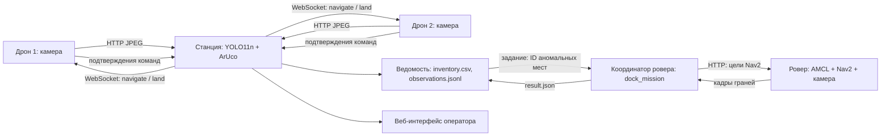

# Автоматическая инвентаризация открытой площадки хранения

**Хайтек: навыки будущего — 2026.** Компетенция «Технологии ИИ в комплексных беспилотных системах».
Команда НИЯУ МИФИ. Кейс № 1 «Автоматическая инвентаризация открытой площадки хранения без остановки работ».

## Содержание

1. [О проекте](#1-о-проекте)
2. [Состав аппаратов](#2-состав-аппаратов)
3. [Архитектура системы](#3-архитектура-системы)
4. [Алгоритм выполнения миссии](#4-алгоритм-выполнения-миссии)
5. [Обмен данными между аппаратами](#5-обмен-данными-между-аппаратами)
6. [Системы координат и пересчёт](#6-системы-координат-и-пересчёт)
7. [Распознавание и ведомость](#7-распознавание-и-ведомость)
8. [Установка](#8-установка)
9. [Запуск миссии](#9-запуск-миссии)
10. [Интерфейс оператора](#10-интерфейс-оператора)
11. [Проверки и испытания](#11-проверки-и-испытания)
12. [План работ и сроки](#12-план-работ-и-сроки)
13. [Команда](#13-команда)
14. [Ограничения и развитие](#14-ограничения-и-развитие)
15. [Материалы](#15-материалы)

## 1. О проекте

**Цель:** автоматически определить состояние каждого места хранения на открытой площадке
и сформировать единую ведомость фактического наличия без остановки работ склада.

Места хранения обозначены ArUco-метками (45 мест, ID 100–144). Для каждого места система
определяет состояние:

| Состояние | Значение |
|---|---|
| `occupied` — занято | На месте обнаружена коробка |
| `empty` — пусто | Метка видна, коробки рядом нет |
| `anomaly` — аномальное | Обнаружена повреждённая коробка (`box_hitech_defect`) |
| `unknown` — не осмотрено | Метка не попала в кадр ни одного аппарата |

Дроны выполняют обзор площадки сверху, станция распознаёт коробки и собирает ведомость,
ровер осматривает боковые грани аномальных и спорных мест. Решение ровера по месту
считается окончательным.

## 2. Состав аппаратов

| Аппарат | Количество | Роль | Программное обеспечение |
|---|---|---|---|
| Квадрокоптер «Сверх» (Обрик, ROS 2) | 2 | Облёт площадки по маршруту, съёмка сверху | `drone/aruco_nav/ws_flight.py` + SDK `sverk_interfaces` |
| Ровер «Сверх» с лидаром и камерой | 1 | Осмотр боковых граней по заданию от дронов, возврат в нишу | `rover/dock_mission.py` + штатные AMCL и Nav2 |
| Ноутбук (станция) | 1 | Распознавание, ведомость, управление маршрутами, интерфейс оператора | `station/`, `YOLO/scripts/` |

Два дрона и один ровер — минимальный состав, при котором площадка 7,5 × 4,5 м делится на
две зоны облёта, а наземная проверка выполняется только для отобранных мест.

## 3. Архитектура системы



### Разделение программного обеспечения

| Программное обеспечение | Источник | Назначение |
|---|---|---|
| `sverk_interfaces`, бортовой ROS 2 дрона | Поставка «Сверх» | Полётный контроллер, локализация по ArUco, камера |
| AMCL, Nav2, веб-API ровера | Поставка «Сверх» | Локализация и движение ровера по карте |
| `station/` | Команда | Единый запуск, сбор кадров, маршруты, ведомость, веб-интерфейс |
| `drone/aruco_nav/` (`ws_flight.py`, `ws_control.py`, `mission.py`) | Команда | Полётный клиент дрона, сервер команд, проверка маршрутов |
| `YOLO/scripts/` (`box_detector.py`, `scan_two_drones.py`, `field_report.py`) | Команда | Детекция, привязка коробки к метке, фильтр ложных рамок, голосование, отчёт качества |
| `shared/match_box.py` | Команда | Геометрическая привязка рамки коробки к ArUco-метке |
| `rover/` (`dock_mission.py`, `dock_navigation.py`, `field.py`, `mission.py`) | Команда | Пересчёт ArUco → Nav2, планирование осмотра, выезд из ниши и возврат, анализ граней |
| Обученные веса YOLO11n (дрон и ровер) | Команда | Классы `box_hitech`, `box_hitech_defect` |
| Ultralytics, OpenCV contrib, NumPy, websockets, aiohttp | Сторонние библиотеки | Нейросеть, ArUco, вычисления, связь, веб-сервер |

## 4. Алгоритм выполнения миссии

| Этап | Действие | Исполнитель |
|---|---|---|
| 1. Подготовка | Карта ArUco загружена на дроны; ровер стоит в нише; станция запущена одной командой и получает кадры с обеих камер | Оператор, станция |
| 2. Подключение | Дроны регистрируются на станции по ID; интерфейс показывает оба подключения и свежесть кадров | Дроны, станция |
| 3. Облёт | Оператор нажимает «Запустить маршруты»; станция отправляет каждому дрону точки маршрута и ждёт подтверждения каждой команды | Станция, дроны |
| 4. Распознавание | Каждый кадр обрабатывается YOLO11n и детектором ArUco; коробка привязывается к ID места; наблюдения записываются в журнал | Станция |
| 5. Ведомость | Наблюдения объединяются: один ID — одна строка, класс выбирается голосованием по уверенности; неосмотренные места отделены от пустых | Станция |
| 6. Посадка | После последней точки станция отправляет `land`; дрон подтверждает выключение моторов | Станция, дроны |
| 7. Задание роверу | Места со статусом «аномальное» и спорные места передаются координатору ровера в виде JSON-задания | Станция → ровер |
| 8. Наземная проверка | Ровер выезжает из ниши, объезжает коробки, снимает каждую доступную грань трёх кадрами, возвращается в нишу | Ровер |
| 9. Итог | Результат ровера (`result.json`) уточняет ведомость; оператор скачивает CSV | Ровер, станция |

**Нештатные ситуации:**

- Ошибка команды или разрыв связи — дрон выполняет посадку с подтверждением по телеметрии (до трёх попыток).
- Таймаут ответа — станция закрывает соединение, поздний ответ не засчитывается следующей команде.
- Повторное подключение с тем же ID и подключение без ID отклоняются.
- Расхождение локализации ровера с одометрией — миссия ровера останавливается.
- Кнопка «Завершить маршрут и посадить» прекращает облёт после текущей команды.

## 5. Обмен данными между аппаратами

| Канал | Протокол | Направление | Данные |
|---|---|---|---|
| Кадры камер | HTTP, JPEG | Дрон → станция | Снимки с камеры `/camera_1/image_raw` |
| Маршруты и посадка | WebSocket, JSON | Станция → дрон | `navigate` (x, y, z, yaw, frame_id), `land` |
| Подтверждения | WebSocket, JSON | Дрон → станция | Результат выполнения каждой команды |
| Задание роверу | JSON-файл | Станция → координатор ровера | ID мест для проверки, флаг аномалии, смещение коробки |
| Цели движения | HTTP, веб-API ровера | Координатор → ровер | Позы Nav2, начальная поза AMCL, остановка |
| Результат ровера | JSON-файл | Ровер → станция | Решение по каждой грани и по месту, статус возврата в нишу |

**Регистрация дрона:** клиент отправляет строку с ID (`drone3`), станция отвечает `{"type":"registered"}`.

**Команда и ответ:**

```json
{"command": "navigate", "params": {"x": 2.5, "y": -1.5, "z": 2, "yaw": 0, "frame_id": "aruco_map"}}
{"type": "result", "command": "navigate", "ok": true}
```

**Задание роверу** (`rover/drone_job.example.json`):

```json
{"schema_version": 1, "mission_id": "attempt-001",
 "boxes": [{"marker_id": 112, "anomaly": true}, {"marker_id": 122, "anomaly": false}]}
```

**Результат ровера** (`attempts/<mission_id>/result.json`): `mission_id`, `status`,
`returned_to_dock` и массив `inspections` с полями `marker_id`, `side_anomaly`, `faces`.

Одновременно для каждого дрона выполняется одна команда. Подробное описание миссии ровера —
[rover/DOCK_MISSION.md](rover/DOCK_MISSION.md).

## 6. Системы координат и пересчёт

| Система | Начало и оси | Единицы | Где используется |
|---|---|---|---|
| `aruco_map` | Центр поля 7,5 × 4,5 м | Метры | Маршруты дронов, адреса мест |
| Карта Nav2 ровера (`field_01`) | Начало карты SLAM, разрешение 0,05 м/пиксель | Метры | Навигация ровера |
| Изображение | Левый верхний угол кадра | Пиксели | Привязка коробки к метке |

**ID → координаты места.** Карта [`aruco_map_750x450_id100.txt`](drone/aruco_nav/aruco_map_750x450_id100.txt):
45 меток DICT_4X4_1000, 9 столбцов × 5 рядов, шаг 0,75 м.

```text
i = marker_id − 100;   x = −3,00 + 0,75 · (i mod 9);   y = −1,50 + 0,75 · ⌊i / 9⌋
```

Контроль по файлу карты: ID 100 → (−3; −1,5), ID 122 → (0; 0), ID 144 → (3; 1,5).

**Пересчёт aruco_map → Nav2 (дроны → ровер).** Используется плоское преобразование поворота
и переноса, параметры которого вычисляются при каждом запуске по четырём опорным меткам
100, 108, 136 и 144, отмеченным на карте площадки `field_01` (снята штатным SLAM ровера 11.11.2026):

```text
x_nav2 = cos θ · x_aruco − sin θ · y_aruco + tx
y_nav2 = sin θ · x_aruco + cos θ · y_aruco + ty
```

| Параметр | Значение |
|---|---|
| Поворот θ | ≈ 27,95° |
| Перенос (tx; ty) | (7,865; 8,0625) м |
| Максимальная невязка на опорных метках | 3,2 см |

Реализация — [`rover/field.py`](rover/field.py), проверка локализации по одометрии во время
движения — [`rover/mission.py`](rover/mission.py). Протокол контрольных измерений —
[docs/FIELD_CHECK.md](docs/FIELD_CHECK.md), таблица — [docs/coordinate_check.csv](docs/coordinate_check.csv).

## 7. Распознавание и ведомость

### Метод

1. **Детекция коробок** — YOLO11n, дообученная на собственных кадрах площадки, два класса:
   `box_hitech` (исправная коробка) и `box_hitech_defect` (повреждённая).
2. **Адрес места** — детектор ArUco OpenCV (DICT_4X4_1000).
3. **Привязка** — рамка коробки сопоставляется с ближайшей меткой по заданной стороне
   (`--match-angle 0/90/180/270`, выбирается по ориентации камеры на кадре площадки).
4. **Фильтр** — рамки, перекрывающие декодированную метку на 50 % и более, отбрасываются.
5. **Объединение** — на адрес за кадр берётся один голос наибольшей уверенности; итоговый класс —
   по сумме уверенности последних девяти наблюдений.

### Модели и качество

| Модель | Данные | Метрики |
|---|---|---|
| Дрон, двухклассовая (`YOLO/scripts/best_for_classificator(2).pt`) | Собственные кадры с дронов, разбиение по съёмочным сессиям | Лучшая эпоха журнала обучения: Precision 0,717, Recall 0,846, mAP50 0,818, mAP50-95 0,401 |
| Дрон, одноклассовая базовая | 78 / 17 / 16 кадров | Валидация: Precision 0,997, Recall 1,000, mAP50 0,995 |
| Ровер, двухклассовая (`rover/yolo_two_classes/rover-yolo-two-classes.pt`) | 23 тестовых кадра боковых граней с площадки | mAP50 0,374, mAP50-95 0,179 |

Параметры: вход 640, порог уверенности 0,25 на станции и 0,60 на ровере, вычисления на CPU.
Обучение и разбиение данных — [YOLO/YOLO11n_models/YOLO_model_classificator/README.md](YOLO/YOLO11n_models/YOLO_model_classificator/README.md),
метрики ровера — [rover/yolo_two_classes/rover-yolo-two-classes-metrics.json](rover/yolo_two_classes/rover-yolo-two-classes-metrics.json).

**Покадровый отчёт** на кадрах с площадки (исходник, рамки, уверенность, ID, CSV):
[reports/repository_frames](reports/repository_frames/index.html). С файлом ручной разметки
`--labels labels.json` скрипт считает TP / FP / FN при IoU ≥ 0,5, Precision и Recall:

```bash
python YOLO/scripts/field_report.py --images <кадры> --labels labels.json --output reports/field
```

### Результаты попытки

Каждый запуск станции создаёт каталог `attempts/<UTC-время>/`:

| Файл | Содержимое |
|---|---|
| `inventory.csv` | Все 45 ID: состояние, координаты метки, источник решения |
| `addresses.txt` | Состояния прочитанных мест |
| `addresses.coverage.json` | Покрытие, неосмотренные ID, ошибки камер, голоса, коробки без ID |
| `observations.jsonl` | Время, источник и результат каждого обработанного кадра |
| `frames/drone1`, `frames/drone2` | Исходные и размеченные кадры |
| `scan.log` | Журнал процесса распознавания |

Результаты ровера сохраняются в `attempts/<mission_id>/result.json` вместе с кадрами граней.

## 8. Установка

**Требования станции:** Linux, Python 3.10–3.12, общая сеть с дронами и ровером.
ROS 2 и SDK на станции не нужны.

```bash
git clone https://github.com/smifick/High_Tech_2026.git
cd High_Tech_2026
python3 -m venv .venv
source .venv/bin/activate
python -m pip install --upgrade pip
python -m pip install torch torchvision --index-url https://download.pytorch.org/whl/cpu
python -m pip install -r requirements-station.txt
python -m station --help
```

Если после установки Ultralytics в OpenCV нет `cv2.aruco.ArucoDetector`, переустановите contrib-сборку:

```bash
python -m pip uninstall -y opencv-python opencv-python-headless opencv-contrib-python
python -m pip install --force-reinstall 'opencv-contrib-python-headless>=4.10,<5'
```

**Дроны:** карта `drone/aruco_nav/aruco_map_750x450_id100.txt` копируется в
`~/sverk_ws/src/sverk_drone/odometry/aruco/aruco_map/config/`, затем
`sudo systemctl restart sverk-ros2-docker.service` ([drone/README.md](drone/README.md)).

**Ровер:** один раз заполнить позу ниши в `rover/dock.field_01.json` ([rover/DOCK_MISSION.md](rover/DOCK_MISSION.md)).

## 9. Запуск миссии

**1. Станция** (на ноутбуке, из корня проекта):

```bash
python -m station \
  --cameras 'http://10.11.3.225:8080/snapshot?topic=/camera_1/image_raw' \
            'http://10.11.3.179:8080/snapshot?topic=/camera_1/image_raw' \
  --routes drone/aruco_nav/routes.example.json
```

Одна команда запускает сервер команд (порт 8000), сбор и распознавание кадров и веб-интерфейс.

**2. Дроны** (на каждом аппарате, вместо `IP_НОУТБУКА` — адрес станции):

```bash
python3 drone/aruco_nav/ws_flight.py --server ws://IP_НОУТБУКА:8000 --id drone3
python3 drone/aruco_nav/ws_flight.py --server ws://IP_НОУТБУКА:8000 --id drone4
```

**3. Облёт.** Открыть `http://127.0.0.1:8088`, убедиться, что подключены оба дрона и кадры свежие,
нажать **«Запустить маршруты»**. После посадки скачать ведомость кнопкой в интерфейсе.

**4. Ровер** (задание `boxes.json` формируется по ведомости попытки):

```bash
python -m rover.dock_mission plan --job boxes.json --dock rover/dock.field_01.json --snapshot rover/field_01.snapshot.json --output plan.json
python -m rover.dock_mission run  --job boxes.json --dock rover/dock.field_01.json --output attempts/attempt-001
```

`plan` сохраняет точки осмотра и PNG для визуальной проверки, `run` выполняет миссию с
возвратом в нишу.

**Остановка:** кнопка «Завершить маршрут и посадить» → дождаться посадки → `Ctrl+C` в окне станции.
Ровер останавливается `Ctrl+C` в окне координатора или командой `python -m rover.mission stop`.

**Только распознавание, без полёта** (проверка камер и модели):

```bash
python YOLO/scripts/scan_two_drones.py \
  --servers 'http://10.11.3.225:8080/snapshot?topic=/camera_1/image_raw' \
            'http://10.11.3.179:8080/snapshot?topic=/camera_1/image_raw' \
  --headless --rounds 10 --save-frames runs/scan_debug
```

## 10. Интерфейс оператора

Во время работы оператор видит в браузере (`http://127.0.0.1:8088`):

- состояние миссии: ожидает запуска, маршруты выполняются, завершено, ошибка с текстом;
- подключённые и ожидаемые дроны;
- состояние сбора кадров и давность последнего кадра с каждой камеры;
- покрытие площадки: сколько мест из 45 осмотрено и список неосмотренных ID;
- предупреждение о коробках без привязки к метке;
- текущую ведомость и ссылки на скачивание CSV, покрытия и журнала наблюдений.


Запуск маршрутов заблокирован, пока не подключены оба дрона и не работает сбор кадров;
оператор получает сообщение о причине.

## 11. Проверки и испытания

**Автоматические тесты:**

```bash
python -m unittest discover -s YOLO/scripts -p 'test_*.py' -v
python -m unittest discover -s tests -v
```

Покрывают получение HTTP-снимков и ошибки камер, геометрию привязки к ArUco, фильтр рамок
на метках, объединение двух источников, сохранение ведомости, интерфейс станции и полётный
протокол с имитацией двух дронов. Результаты — [docs/VALIDATION.md](docs/VALIDATION.md).

**План испытаний на площадке:**

| № | Проверяемая функция | Критерий успеха |
|---|---|---|
| 1 | Камеры и распознавание | Обе камеры дают кадры; коробки привязаны к ID |
| 2 | Маршруты двух дронов | Оба дрона проходят свои точки и садятся без перезапуска |
| 3 | Связь станция — дроны | Каждая команда подтверждена; ошибки видны в интерфейсе |
| 4 | Ведомость | Все 45 ID в `inventory.csv`; сверка с фактической расстановкой |
| 5 | Пересчёт координат | Ровер подъезжает к заданной метке; ошибка измеряется по [docs/FIELD_CHECK.md](docs/FIELD_CHECK.md) |
| 6 | Наземная проверка | Ровер осматривает места из задания и возвращается в нишу |
| 7 | Полный сценарий | Дроны → ведомость → ровер → итоговый CSV в пределах отведённого времени |

## 12. План работ и сроки

| Этап | План | Факт | Результат |
|---|---|---|---|
| Подготовка | до 10.11 | 10.11 | Датасет, обучение YOLO11n, веса |
| Модуль A — разработка | до 11.11 | 12.11 | Станция, маршруты двух дронов, ведомость, миссия ровера, интерфейс |
| Модуль B — испытания | 12.11 | 12.11 | Автоматические тесты; полевые испытания по плану раздела 11 |
| Модуль C — экономика | до 13.11 | 12.11 | [Экономическая эффективность](НИЯУ%20МИФИ_Экономическая%20эффективность.docx) |
| Модуль D — защита | 13.11 | — | Презентация и защита |

## 13. Команда

| Участник | Роль | Результат |
|---|---|---|
| Васильев Матвей | Датасет, пилотирование, документация | Датасет, подготовка техники, документация |
| Смирнова Татьяна | Компьютерное зрение, обучение моделей, экономика | Обученные модели, расчёт экономической эффективности |
| Мамедов Дмитрий | Программирование, интеграция, руководство | Станция, полётный клиент, миссия ровера |

## 14. Ограничения и развитие

- Модель различает исправные и повреждённые коробки; посторонние предметы отдельным классом не распознаются.
- Сторона привязки коробки к метке (`--match-angle`) настраивается под ориентацию камер перед попыткой.
- Состояние «пусто» означает, что рядом с видимой меткой коробка не обнаружена.
- WebSocket-сервер не использует аутентификацию — станция работает в изолированной сети оборудования.

**Развитие:** автоматическая передача задания роверу сразу после посадки дронов, класс
«посторонний предмет», расширение до 4 дронов для больших площадок.

## 15. Материалы

- [Экономическая эффективность (DOCX)](НИЯУ%20МИФИ_Экономическая%20эффективность.docx) и [расчёты](economic/readme.md)
- [Миссия ровера](rover/DOCK_MISSION.md), [наземный осмотр](rover/README.md)
- [Сбор с двух камер](YOLO/scripts/TWO_DRONES.md)
- [Обучение двухклассовой модели](YOLO/YOLO11n_models/YOLO_model_classificator/README.md)
- [Проверки интеграции](docs/VALIDATION.md), [методика полевой проверки](docs/FIELD_CHECK.md)
- Расширенная панель отладки — [web_station/README.md](web_station/README.md)
- [Оборудование «Сверх»](https://edu.sverk.tech), [SDK дрона](https://github.com/sverk-tech/sverk-ros2), [ПО ровера](https://github.com/wodocanal/sverk_rover)
